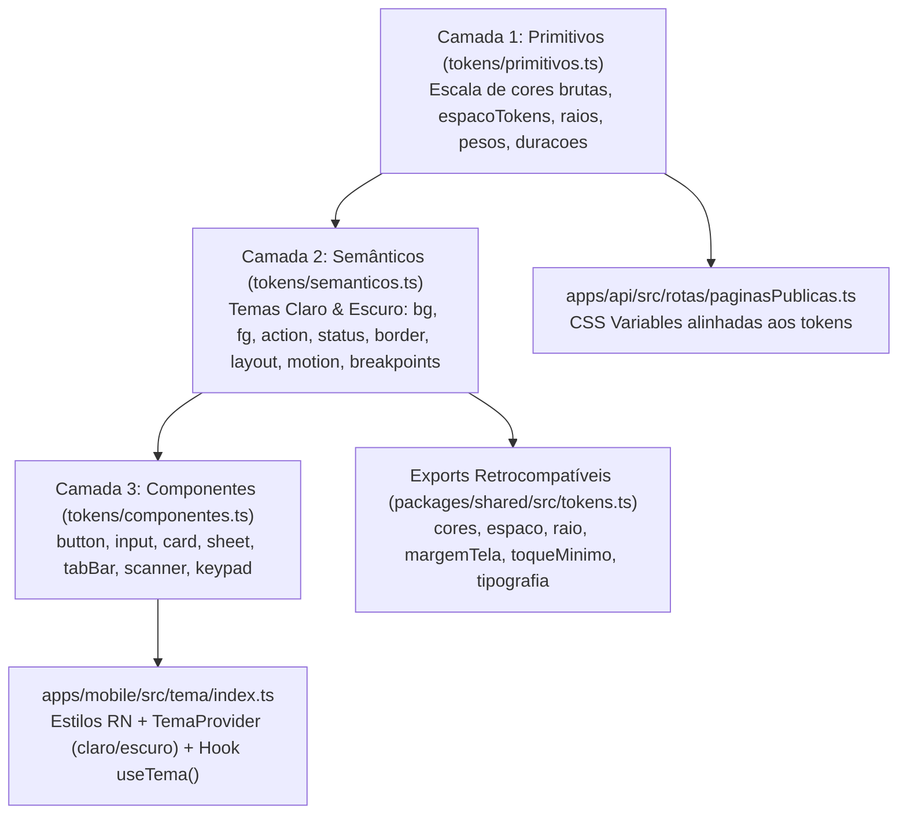
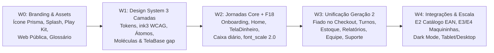

# Pacote Escalável de Melhorias de Design — Prisma PDV (UX, UI, Visual & Branding)

**Referência analisada:** versão `0.1.18` (`versionCode 19`, commit base `72b43ae` + checkout de `CP 158`), 17/11/2026 (`America/Sao_Paulo`).
**Superfícies cobertas:** aplicativo Android/Web (`apps/mobile`), tokens compartilhados (`packages/shared/src/tokens.ts`), identidade e ativos (`apps/mobile/assets/*`, `apps/mobile/app.json`) e páginas públicas web (`apps/api/src/rotas/paginasPublicas.ts`).
**Metodologias integradas:** `/impeccable` (`critique`, `audit.native`, `android`, `operate`, `extract`, `clarify`), `/ui-ux-pro-max`, `/ui-styling`, `/design` e `/design-system`.

---

## 1. Diagnóstico Executivo, Scorecard e Veredito de Especificidade

### 1.1 Modo de Superfície (`/impeccable`)
- **App Operacional (`apps/mobile`) — Modo `Operate`**: o lojista e os operadores usam o Prisma PDV sob fila no balcão, iluminação variada (às vezes luz solar direta) e operação com uma única mão. A ambição visual deve se traduzir em **precisão, escaneabilidade imediata, contraste alto, consistência absoluta de padrões e familiaridade Material 3 temática**.
- **Momentos `Persuade`**: `boas-vindas.tsx`, `planos.tsx`, `cartao.tsx` e os materiais da Google Play Store — onde clareza de proposta de valor e confiança comercial definem ativação e conversão.
- **Páginas Públicas (`apps/api/src/rotas/paginasPublicas.ts`) — Modo `Read`**: privacidade, termos e instrução de exclusão de conta exigidos pela Google Play; precisam de tipografia legível, hierarquia limpa e coerência com a marca Prisma PDV.

### 1.2 Veredito de Especificidade: A Ruptura "Duas Gerações de Interface"
A inspeção integral do código revela que o aplicativo hoje possui **duas gerações visuais antagônicas** convivendo no mesmo APK:

1. **Geração 1 — Sistema "Balcão" v0.1** (`TelaVender`, `ItensDoCarrinho`, `TelaCheckout`, `TelaDinheiro`, `TelaSucesso`, `ListaProdutos`, `ResumoCaixa` e `ListaVendas`):
   - Identidade autoral forte inspirada nos princípios descritos em `docs/design-system.md`: tipografia display expressiva (`Bricolage Grotesque` + `Inter` tabular), alto contraste `ink` (`#14112B`) sobre branco, superfície quente (`#F4F2EE`), acento solar único (`manga #FFC933`) e 15 ilustrações proprietárias "aquarela 3D" em `apps/mobile/src/componentes/ilustracoes/`.
2. **Geração 2 — Telas Operacionais R1–R5** (`TurnosCaixa.tsx`, `Estoque.tsx`, `Fiado.tsx`, `Relatorios.tsx`, `Lojas.tsx`, `equipe.tsx`, `usuarios.tsx`, `Suporte.tsx`):
   - Construídas para entregar integridade de domínio multiusuário, multiloja, offline e fiscal-operacional, porém **sem usar a camada de moléculas do design system**:
     - Exibem **UUIDs completos** na UI (`TurnosCaixa.tsx:62,69-70`, `Estoque.tsx:40,46`, `DetalheVenda.tsx:73,81-82`, `Suporte.tsx:83`);
     - Expõem **códigos técnicos internos** como `cofre_deposito` / `reforco_troco` (`MovimentoDeCaixa.tsx:50,120`) e papéis sem capitalização (`dono`, `gerente`, `operador` em `entrar.tsx:182`, `Lojas.tsx:22`, `equipe.tsx:51`);
     - Improvisam seletores únicos com botões `<Botao rotulo="Selecionado: ..." />` empilhados (`Estoque.tsx:32`, `Fiado.tsx:65,78,84`, `Relatorios.tsx:38-45`) ou caracteres Unicode `'● ' / '○ '` (`entrar.tsx:172,182`);
     - Deixam textos e alertas em `<Texto>` puro sem `<Banner>` (`ResumoCaixa.tsx:69`, `StatusSincronizacao.tsx:89`, `TurnosCaixa.tsx:57`, `comum.tsx:43-44`, `Suporte.tsx:71,74`);
     - Sofrem de **`gap: 0` vertical** em `equipe.tsx:45` e `usuarios.tsx:19` porque `TelaBase.tsx:49` não define espaçamento padrão no `ScrollView`.

### 1.3 Scorecard Heurístico de Nielsen (`/impeccable critique`)

> `Method: design review only (detector not applicable, native platform)` — Avaliação sobre `apps/mobile` (`0.1.18`)

| # | Heurística | Nota | Achado Principal e Evidência no Código |
|---|---|---|---|
| 1 | Visibilidade do status do sistema | **3/4** | Excelente em `StatusPill`, flash `"Bip!"` em `Scanner.tsx:200-206` e `StatusSincronizacao.tsx`; falha no progresso do onboarding que salta de `2 de 6` (`loja.tsx:59`) direto para `5 de 6` (`pagamentos.tsx:15`) quando a cobrança está liberada, no selo `"Leitor ativo"` enquanto a permissão ainda é `null` (`Scanner.tsx:89-90`, `CP 143`) e no toast de erro de licença em foreground (`app/_layout.tsx:137`, `CP 155/158`). |
| 2 | Correspondência sistema / mundo real | **2/4** | Geração 1 fala a língua do balcão; Geração 2 vaza enums `cofre_deposito`/`reforco_troco` (`MovimentoDeCaixa.tsx:50,120`), UUIDs crus (`TurnosCaixa.tsx:62,69-70`, `Estoque.tsx:40,46`), três termos para o mesmo movimento ("Entrada" vs "Suprimento" vs "Suprimentos", `CP 123`) e papéis em minúscula (`equipe.tsx:51`, `Lojas.tsx:22`). |
| 3 | Controle e liberdade do usuário | **3/4** | Bom "Desfazer" ao remover item (`TelaVender.tsx:120`) e `BackHandler` seguro em `TelaSucesso.tsx:50-57`; falha em `criar-conta.tsx:92,106-107`, onde `"Solicitar outro código"` executa `voltarAosDados()` (apaga o desafio em vez de reenviar OTP) e o botão Voltar sai da tela em vez de retornar à edição dos dados. |
| 4 | Consistência e padrões | **2/4** | Forte ruptura entre Geração 1 e Geração 2; coexistência de `CampoPreco` (teclado próprio de centavos) com `<Campo keyboardType="decimal-pad">` sem máscara (`FecharCaixa.tsx:94`, `TurnosCaixa.tsx:76`); três implementações de radio button (`CartaoPlano`, `'● '/'○ '` em `entrar.tsx`, `<Botao rotulo="Selecionado: ...">`); linhas clicáveis sem chevron em `ajustes/index.tsx:72-75,133`. |
| 5 | Prevenção de erros | **3/4** | Travas de domínio sólidas (cobrança parcial bloqueia saída, debounce de leitura repetida, trava de saldo na sangria); risco de erro de 100× em `FecharCaixa.tsx:38,94` (`trocoFica` em texto livre `'0'`, `CP 130`) e datas digitadas manualmente sem máscara (`Fiado.tsx:75`, `Relatorios.tsx:34-35`). |
| 6 | Reconhecimento em vez de memorização | **2/4** | `TurnosCaixa.tsx:83,87-88` e `Estoque.tsx:40` exigem copiar/colar UUIDs entre telas/campos; `MovimentoDeCaixa.tsx:119-124` posiciona Categoria/Origem/Motivo abaixo do teclado numérico (`CP 151`); `ResumoCaixa.tsx:125-146` esconde `Entrada / Sangria / Retirada` abaixo da dobra depois de `Fechar caixa` (`CP 123`). |
| 7 | Flexibilidade e eficiência de uso | **3/4** | Ótimos aceleradores (`CadastroRapido`, `atalhos`, `+5` no `Stepper`, notas sugeridas em `TelaDinheiro`); lacuna operacional no **Fiado**, ausente como meio de pagamento em `TelaCheckout.tsx:60-73` e exigindo remontar a venda em `Fiado.tsx:66-72`. |
| 8 | Estética e design minimalista | **2/4** | Base cromática e tipográfica forte, porém enfraquecida por: (a) ícone e splash padrão de fábrica do Expo em `apps/mobile/assets/*`; (b) dois CTAs primários `manga` `"Vender"` visíveis ao mesmo tempo na Home (`app/(tabs)/index.tsx:93` + `BarraInferior.tsx:56`); (c) excesso de texto e metadados técnicos nas telas R1–R5; (d) `planoMinimoPara()` exibindo `"Negócio"` (`packages/shared/src/planos.ts:103-107`) quando a oferta atual é Plano Único `Pro` (`docs/assinatura-unica-e-cupons.md`). |
| 9 | Diagnóstico e recuperação de erros | **3/4** | Bom `Campo.tsx` com anúncio acessível e atalho `"Abrir esse produto"` em EAN duplicado (`FormularioProduto.tsx:221-228`); `TelaGestao` (`comum.tsx:44`) coloca a mensagem de erro apenas no topo da rolagem, fora de vista quando o usuário toca no botão ao pé da tela; `Suporte.tsx:78` desabilita o envio com `< 10` caracteres sem informar o mínimo. |
| 10 | Ajuda e documentação | **2/4** | Regras financeiras precisas e `Suporte` acessível sem login, porém apresentadas em blocos corridos sem abas ou divulgação progressiva (`Suporte.tsx:62-93`, `Relatorios.tsx:33,51`). |
| **Total** | | **25/40** | **Acceptable (62,5%) — Fundação visual excelente nas telas core, puxada para baixo por R1–R5, branding inacabado e atritos de fluxo** |

### 1.4 Scorecard Técnico Nativo (`/impeccable audit.native`)

| # | Dimensão | Nota | Achado Principal |
|---|---|---|---|
| 1 | Acessibilidade (TalkBack / Escala / Contraste) | **2/4** | 0 controles sem rótulo no ADB (`CP 144`), `tabular-nums`, `falarDinheiro`, `useReducaoMovimento`; porém falha em `font_scale 2.0 + 360dp` (`CP 144`: sobreposição em `TelaDinheiro` e `FecharCaixa`, corte de `"Ajustes"` na `BarraInferior`, corte de `"Entrada/Sangria/Retirada"` em `ResumoCaixa`, quebra `"Dinh/eiro"`), além de `ink3` com `4.19:1` sobre `surface2` e papéis ARIA incorretos (`Chip` como `button` em `radiogroup`, `TilePagamento` como `switch`). |
| 2 | Performance | **3/4** | SVGs otimizados sem filtros custosos, `FlatList` com `removeClippedSubviews={false}` (estabilidade Android Fabric), animações com `useNativeDriver: true`; oportunidades em virtualização do carrinho (`ItensDoCarrinho.tsx:43` usa `ScrollView`) e `Skeleton` no lugar de bloqueio total por `ActivityIndicator`. |
| 3 | Aparência e Tematização | **2/4** | Tema exclusivamente claro (`app.json:9`), tokens planos de 1 camada (`packages/shared/src/tokens.ts`), ~18 valores de cor hardcoded em componentes e ilustrações, e páginas web públicas (`paginasPublicas.ts:11`) sem os tokens da marca. |
| 4 | Conformidade com Android (Material 3) | **3/4** | Boa cobertura de `SafeAreaView` e `BackHandler`; faltam `android_ripple` / state layers, gesto de arrastar na alça do `BottomSheet.tsx:42` (hoje decorativa) e revisão da flag `predictiveBackGestureEnabled: false` (`app.json:22`). |
| 5 | Adaptabilidade (Telas pequenas, Tablets, Desktop) | **2/4** | Travado em retrato (`app.json:7`), `TelaDinheiro` não-rolável em telas baixas, `TelaBase.tsx:49` sem `gap` padrão e ausência de `NavigationRail` / layout 2 colunas para janelas `>= 840dp` (já previsto como próximo passo em `docs/design-system.md:3`). |
| **Total** | | **12/20** | **Acceptable — Sólida base técnica de Android, requerendo camada responsiva e refinamento sistêmico** |

### 1.5 Personas de Teste e Pontos de Ruptura
- **Dona Cida (Lojista / Caixa de Mercadinho — Primeira Vez / Sob Fila)**: trava no salto `2 de 6 → 5 de 6` no cadastro, lê `"cofre_deposito"` ao fazer sangria, não enxerga os botões `Entrada/Sangria/Retirada` escondidos abaixo de `Fechar caixa` (`CP 123`), e tenta cobrar uma venda fiada direto no checkout sem encontrar a opção.
- **Bruno (Operador de Caixa Rápido — Power User)**: quer bipar 30 itens, ajustar um fardo de 12 unidades sem tocar 12 vezes no `Stepper`, e fechar o caixa sem errar casas decimais no campo `"Troco que permanece na gaveta"` sem máscara (`CP 130`).
- **Seu Marcos (Dono Multiloja — Conferência e Gestão)**: vê dois botões `"Vender"` na Home, precisa entrar em `Ajustes` (em linhas sem seta visual) para achar `Relatórios`, `Estoque` e `Fiado`, e encontra UUIDs de 36 caracteres na conferência de turnos (`CP 131`).

---

## 2. Camada 0 — Branding, Identidade Visual, Assets & Voz (`/design` + `/brand`)

### 2.1 Diagnóstico Crítico de Branding (Bloqueio de Loja)
1. **Ícones e Splash de Fábrica do Expo (`P0` para Google Play)**:
   - Os arquivos `apps/mobile/assets/icon.png` (chevron azul sobre grid de construção) e `apps/mobile/assets/splash-icon.png` (mira circular branca sobre grade preta), assim como `android-icon-foreground.png`, ainda são **placeholders padrão do template Expo**, combinados com `backgroundColor: "#FFC933"` em `apps/mobile/app.json:17`. Publicar na Play Store com esse ícone gera rejeição de marca ou perda imediata de credibilidade comercial.
2. **Documentação Defasada**:
   - `docs/design-system.md:3` ainda afirma `"Sem nome ainda: o wordmark usa o placeholder [nome]"`, enquanto o produto já possui nome oficial **Prisma PDV** (`apps/mobile/app.json:3`, `boas-vindas.tsx:24`, `CP 157`) e canal público `contato@prumo.services` (`CP 153`).

### 2.2 Sistema de Identidade Visual "Prisma Balcão"
- **Conceito do Símbolo (Logo Mark)**:
  - **Geometria**: um **prisma triangular equilátero com vértices suavizados** (conectado ao raio orgânico do design system), atravessado por **três feixes paralelos de espessuras distintas** que remetem simultaneamente à refração prismática (clareza sobre os números da loja) e a um **código de barras EAN** (mecânica central de bipar e vender).
  - **Wordmark oficial**: `Prisma PDV` em `Bricolage Grotesque 800`, tracking `-0.02em`, acompanhando o símbolo em barra horizontal apenas na abertura (`boas-vindas.tsx`) e nas páginas públicas (`paginasPublicas.ts`). Nas telas operacionais internas, a marca vive nos detalhes tipográficos e cromáticos sem disputar espaço com os dados.
- **Duas Direções de Adaptive Icon (`108×108dp`, zona segura central `66×66dp`)**:
  - **Direção A — Prisma Noite & Manga (Recomendada)**:
    - `backgroundImage` / `backgroundColor`: `#14112B` (`ink`).
    - `foregroundImage`: prisma facetado em `#FFC933` (`manga`) e `#F2B200` (`mangaStrong`) com feixe central em `#FFFFFF`.
    - *Vantagem*: máximo contraste e presença premium tanto em telas iniciais claras quanto escuras do Android; destaca-se entre ícones genéricos azuis/verdes de varejo.
  - **Direção B — Prisma Solar**:
    - `backgroundColor`: `#FFC933` (`manga`, preservando `app.json:17`).
    - `foregroundImage`: prisma sólido em `#14112B` (`ink`) com brilho interno `#FFF3CC` (`mangaSoft`).
    - *Vantagem*: alta visibilidade imediata em gavetas de aplicativos e continuidade direta com a cor de acento dos botões.
- **Monochrome Icon (`android-icon-monochrome.png`)**: obrigatório no Android 13+ (Material You themed icons) usando **silhueta vetorial 100% preta `#000000` com fundo transparente**, respeitando a zona segura de `66×66dp`.
- **Splash Screen (`expo-splash-screen`)**:
  - Atualizar `apps/mobile/assets/splash-icon.png` para o símbolo Prisma limpo (`160dp` de largura conforme `app.json:48`), eliminando o alvo quadriculado preto e alinhando o fundo ao tema escolhido (`#FFFFFF` com símbolo Noite/Manga, ou `#14112B` com símbolo Manga).
- **Kit Google Play Store (`/design`)**:
  - `icon-play-512.png` (`512×512px`, PNG 32-bit, fundo sólido sem transparência).
  - `feature-graphic-1024x500.png` (`1024×500px`, fundo `ink #14112B`, wordmark `Prisma PDV`, headline em `Bricolage Grotesque 800` *"Seu balcão inteiro no celular"*, ilustração `cesta`/`scanner` e badge de confiança *"Funciona offline · Pix, Cartão e Dinheiro"*).
  - `screenshots-play-01..06.png` (`1080×1920px`, fundo `surface #F4F2EE`, moldura limpa e 1 benefício por tela): (1) Bipe e venda em segundos; (2) Troco na hora e Pix sem erro; (3) Venda mesmo sem internet; (4) Caixa separado por operador; (5) Estoque e fiado na palma da mão; (6) Relatórios prontos em CSV.
- **Páginas Web Públicas (`apps/api/src/rotas/paginasPublicas.ts`)**:
  - Substituir o `<style>` genérico de `pagina()` (`paginasPublicas.ts:11`) por tokens visuais alinhados à marca: fundo `#F4F2EE`, cartão central `#FFFFFF` com borda `1px solid #E2DED6` e `border-radius: 16px`, cor primária `#14112B`, links em `#3346F0`, barra superior com marca `Prisma PDV`, suporte a `@media (prefers-color-scheme: dark)` e espaço explícito para o **nome do desenvolvedor** exigido na ficha de exclusão da Play (`CP 153`).

### 2.3 Voz da Marca & Glossário Canônico de UX Writing (`/impeccable clarify` + `/brand`)
- **Personalidade**: Direta de balcão, calma sob pressão, transparente sobre estado offline e confirmação manual (nunca promete automação que não existe).
- **Regras Obrigatórias de Redação**:

| Termo / Situação Atual (Problema) | Onde Aparece | Padrão Canônico Unificado |
|---|---|---|
| `"Suprimento"` / `"Suprimentos"` / `"Entrada"` / `"Registrar suprimento"` | `MovimentoDeCaixa.tsx:28-32`, `ResumoCaixa.tsx:116`, `packages/shared/src/caixa.ts`, `CP 123` | **"Entrada de troco"** (título e botão) · **"Entradas de troco"** (resumo) · **"Registrar entrada"** (CTA). |
| `"Sangria"` / `"Retirada"` sem contexto | `ResumoCaixa.tsx:127`, `MovimentoDeCaixa.tsx` | Manter **"Sangria"** (subtítulo: *"Guardar no cofre ou banco"*) e **"Retirada"** (subtítulo: *"Despesa ou saída do caixa"*). |
| `reforco_troco`, `cofre_deposito`, `despesa` visíveis no campo | `MovimentoDeCaixa.tsx:50,120`, `TurnosCaixa.tsx:25,81` | **Ocultar códigos internos**. Exibir `Chip`s em português: `"Reforço de troco"`, `"Cofre ou depósito"`, `"Despesa da loja"`, `"Outra saída"`, mapeando internamente para o enum da API. |
| Papéis em minúsculas: `dono`, `gerente`, `operador` | `entrar.tsx:182`, `Lojas.tsx:22`, `equipe.tsx:51` | Helper único `rotuloPapel(papel)`: `"Dono"`, `"Gerente"`, `"Operador"`. |
| UUIDs de 36 chars (`01a1c53e-...`) em destaque | `TurnosCaixa.tsx:62,69-70`, `Estoque.tsx:46`, `DetalheVenda.tsx:73,81-82`, `Suporte.tsx:83` | Exibir rótulo humano (data/hora ou nome) + átomo `<CodigoCurto id={...} />` (`#C53E`) com cópia em 1 toque quando necessário para suporte/transferência. |
| `"Disponível no plano Negócio"` (`planoMinimoPara`) | `ListaProdutos.tsx:32`, `MovimentoDeCaixa.tsx:42`, `ListaVendas.tsx:73`, `FormularioProduto.tsx:79` | Alinhar à oferta vigente em `docs/assinatura-unica-e-cupons.md`: exibir **"Disponível no plano Pro"** quando o catálogo público tiver apenas `'pro'`. |
| `"Solicitar outro código"` que apaga os dados do desafio | `criar-conta.tsx:106` | Separar em **"Reenviar código"** (mantém tela e reenvia com espera de 30 s) e **"Alterar e-mail ou CPF/CNPJ"** (volta ao formulário). |

---

## 3. Camada 1 — Arquitetura Escalável de Design Tokens em 3 Camadas (`/design-system` + `/ui-styling`)

### 3.1 Arquitetura Proposta (Retrocompatível com `@pdv/shared`)

### 3.2 Auditoria de Cores: Contraste WCAG AA & Absorção de Hardcodes
1. **Correção de Contraste WCAG AA (`ink3`)**:
   - Hoje `cores.ink3` é `#6B6883` (`packages/shared/src/tokens.ts:6`).
   - Embora passe `4.5:1` sobre fundo branco `#FFFFFF`, textos com `ink3` são usados extensivamente sobre `surface` (`#F4F2EE` — razão no limite ~4,59:1) e sobre `surface2` (`#EAE7E1` — **abaixo de 4,5:1**, ~4,19:1), como rótulos de seção, subtítulos, legendas e eixos em `Campo`, `CartaoPlano`, `TilePagamento`, `LinhaLista` e `Ajustes`.
   - **Especificação**: ajustar `ink3` para **`#5C5973`** (`>= 5,2:1` mesmo sobre `surface2`, `>= 5,7:1` sobre `surface` e `>= 6,4:1` sobre `bg`), preservando exatamente o matiz violeta-ardósia da marca.
2. **Inventário Completo de Valores Hardcoded a Absorver nos Tokens**:

| Valor Hardcoded | Ocorrência Exata | Token Semântico Destino |
|---|---|---|
| `#F9CBD1` | `apps/mobile/src/componentes/Botao.tsx:34` | `semanticos.action.danger.pressed` |
| `#FF8A9B` | `apps/mobile/src/componentes/Toast.tsx:86` e `Scanner.tsx:40` | `semanticos.status.dangerOnDark` |
| `#1FAF5F` | `apps/mobile/src/componentes/Scanner.tsx:39` | `semanticos.status.successOnDark` |
| `#A9A6BD` | `apps/mobile/src/componentes/Scanner.tsx:38` | `semanticos.fg.mutedOnDark` |
| `rgba(20,17,43,0.4)` | `apps/mobile/src/componentes/BottomSheet.tsx:56` | `semanticos.bg.scrim` |
| `rgba(13,11,26,0.55)` | `apps/mobile/src/componentes/Scanner.tsx:36`, `TelaVender.tsx:285` | `semanticos.bg.cameraOverlay` |
| `rgba(13,11,26,0.62)` | `apps/mobile/src/componentes/Scanner.tsx:452,463` | `semanticos.bg.cameraHud` |
| `rgba(14,122,64,0.85)` | `apps/mobile/src/componentes/Scanner.tsx:37` | `semanticos.status.successFlash` |
| `rgba(255,255,255,0.16)` / `0.28` | `BotaoIcone.tsx:37-38`, `Scanner.tsx:410` | `semanticos.action.translucent.{default,pressed}` |
| `rgba(255,255,255,0.14)` / `0.94` | `Scanner.tsx:451`, `TelaVender.tsx:286` | `semanticos.border.onDarkSubtle` / `bg.cameraBadge` |
| `rgba(255,201,51,0.4)` | `Scanner.tsx:462` | `semanticos.border.accentOnDark` |
| `#FF7A59`, `#E8407A`, `#2EC4B6`, `#7B5CFF`, `#B6E83A` (+ tintas claras) | `apps/mobile/src/componentes/ilustracoes/*.tsx` | `primitivos.ilustra.{coral,magenta,turquesa,violeta,lima}` |

### 3.3 Escala de Espaçamentos, Ritmo e Tipografia Unificada
1. **Espaçamentos Nomeados (`espacoTokens`) + Tokens de Layout**:
   - Hoje `espaco = [4, 8, 12, 16, 24, 32, 48, 64]` (`tokens.ts:25`) obriga o acesso por índice numérico e omite `2`, `6`, `10`, `14`, `20` e `28`, resultando em números avulsos espalhados pelos `StyleSheet`s (`paddingHorizontal: 14`, `padding: 20`, `gap: 6`, `gap: 10`, `gap: 28`).
   - **Especificação**: manter `export const espaco` intacto e introduzir:
     - **Primitivos**: `xxs: 2`, `xs: 4`, `xs2: 6`, `sm: 8`, `sm2: 10`, `md: 12`, `md2: 14`, `lg: 16`, `xl: 20`, `'2xl': 24`, `'3xl': 32`, `'4xl': 48`, `'5xl': 64`.
     - **Semânticos de Layout**: `margemTela: 20`, `gapSecao: 24`, `gapBloco: 16`, `gapItem: 12`, `gapInline: 8`, `gapCompacto: 4`, `paddingCard: 16`, `paddingCardDestaque: 20`, `paddingControle: 14`.
2. **Unificação Tipográfica em `packages/shared/src/tokens.ts`**:
   - Absorver os 7 estilos que hoje vivem isolados em `apps/mobile/src/tema/index.ts:33-50` (`botaoL`, `botaoM`, `botaoS`, `teclado`, `marca`, `monograma`, `legendaForte`) para dentro do contrato de `tipografia`, garantindo fonte única entre app mobile e futura versão web/desktop.
   - Adicionar papel **`codigo`** (`Inter` ou fonte monoespaçada do sistema, `13/18`, peso `500`, `tabular-nums`, tracking `0.04em`) para EANs, códigos curtos `#C53E` e chaves Pix.
   - Definir **`maxScale`** por papel tipográfico para proteger botões, barra inferior e títulos gigantes contra corte em `font_scale 2.0` (`display: 1.35`, `tituloXL: 1.4`, `tituloL: 1.5`, `label/legenda/botao: 1.4–1.5`, `corpo/corpoL: 2.0`).

### 3.4 Novas Categorias de Tokens e Dark Mode Ready
- **`movimento`**: `duracao = { instantaneo: 0, rapido: 120, normal: 180, folha: 220, flash: 350, laser: 900 }` (sempre condicionado a `useReducaoMovimento`).
- **`borda`**: `{ fina: 1, foco: 2, recorte: 4 }`.
- **`opacidade`**: `{ desabilitado: 0.4, bloqueado: 0.75, inativo: 0.6 }`.
- **`camada` (`zIndex`)**: `{ base: 0, visorOverlay: 10, barra: 20, folha: 40, toast: 60 }`.
- **`janela` (`breakpoints` em `dp`)**: `{ estreita: 360, compacta: 600, media: 840, expandida: 1200 }`.
- **Mapa Semântico de Dark Mode (`semanticos.escuro`)** (pronto para ativação via `TemaProvider` sem reescrever telas):

| Papel Semântico | Tema Claro | Tema Escuro (Planejado) |
|---|---|---|
| `bg.canvas` | `#FFFFFF` (`bg`) | `#0D0B1A` (`noite`) |
| `bg.surface` | `#F4F2EE` (`surface`) | `#171429` |
| `bg.surfacePressed` | `#EAE7E1` (`surface2`) | `#221E38` |
| `border.default` | `#E2DED6` (`line`) | `#2F2A4A` |
| `fg.primary` | `#14112B` (`ink`) | `#F6F5FA` |
| `fg.secondary` | `#4A4766` (`ink2`) | `#C4C1D9` |
| `fg.muted` | `#5C5973` (`ink3` ajustado) | `#9692B0` |
| `action.primary.bg` | `#FFC933` (`manga`) | `#FFC933` (`manga`) |
| `action.primary.fg` | `#14112B` (`ink`) | `#14112B` (`ink`) — regra mantida: nunca branco em `manga` |
| `action.focusRing` | `#3346F0` (`anil`) | `#7C8BFF` |
| `status.success.bg / fg` | `#DDF5E7` / `#0E7A40` | `#0F2D1D` / `#5CE092` |
| `status.warning.bg / fg` | `#FFEFD9` / `#A65400` | `#33200B` / `#FFB866` |
| `status.danger.bg / fg` | `#FDE3E6` / `#C8102E` | `#36121A` / `#FF8A9B` |

---

## 4. Camada 2 — Átomos (Auditoria Ponto a Ponto e Especificações)

| Átomo | Estado & Problemas Identificados | Especificação Escalável |
|---|---|---|
| **`Texto`** (`src/componentes/Texto.tsx`) | Sem `maxFontSizeMultiplier` padrão e sem controle de hifenização no Android (causou `"Dinh/eiro"` e `"Espera/do"` em `font_scale 2.0`, `CP 144 #4`). | Receber `maxScale?: number` com padrão automático por `estilo` e aplicar `android_hyphenationFrequency="none"` para evitar quebra no meio da palavra. |
| **`Dinheiro`** (`src/componentes/Dinheiro.tsx`) | Apenas valor absoluto simples; não formata sinal explícito (`+` / `−`) nem redução para sub-valores. | Adicionar `sinal?: 'auto' | 'sempre' | 'oculto'` preservando `falarDinheiro` acessível e `tabular-nums`. |
| **`Icone`** (`src/componentes/Icone.tsx`) | 38 ícones apenas; faltam conceitos de R1–R4 e gestão (obrigou uso de ícones improvisados ou ausência de ícone). | Expandir para ~50 ícones no mesmo estilo `24×24`, traço `2px`, `strokeLinecap="round"`: `estoque`, `pessoa`, `equipe`, `relatorio`, `loja`, `transferir`, `editar`, `calendario`, `compartilhar`, `filtro`, `olho`, `olhoFechado`. |
| **`Ilustra`** (`src/componentes/Ilustra.tsx`) | Tamanho fixo por caller; `AvisoDePausa` (`TelaVender.tsx:252`) invadiu o campo de busca em telas pequenas (`CP 144 #6`); cores fora de `tokens.ts`. | Adicionar `responsivo?: boolean` que reduz o tamanho em 25–35% quando `windowHeight < 700` ou `fontScale > 1.3`, e consumir `primitivos.ilustra`. |
| **`Botao`** (`src/componentes/Botao.tsx`) | Cor `#F9CBD1` hardcoded (`:34`); sem `android_ripple`; botões `M`/`S` lado a lado comprimem texto (`CP 144 #5`). | Usar token semântico de pressed, adicionar `android_ripple` suave e `hitSlop` automático para `tamanho="S"`, e respeitar `flexShrink` sem cortar palavra isolada. |
| **`BotaoIcone`** (`src/componentes/BotaoIcone.tsx`) | **Triplicado no codebase**: existe `BotaoIcone.tsx`, `src/telas/produtos/BotaoRedondo.tsx` e `BotaoRedondo` interno em `Stepper.tsx:39`. | **Consolidar os 3 em um único `BotaoIcone`**, suportando `tamanho?: 48 | 40` (com `hitSlop: 4` no 40 para manter área mínima `48×48dp`), `variante?: 'surface' | 'translucido' | 'ghost'` e `children?: ReactNode`. |
| **`Chip`** (`src/componentes/Chip.tsx`) | Sempre usa `accessibilityRole="button"`, mesmo dentro de `accessibilityRole="radiogroup"` (`loja.tsx:74`); visual único para seleção e atalho. | Adicionar `papel?: 'filtro' | 'radio' | 'atalho'` (emite `role="radio"` quando `radio`) e `icone?: NomeIcone` opcional; distinguir seleção ativa (`ink` no filtro vs `anilSoft` + borda `anil` em rádio). |
| **`StatusPill`** (`src/componentes/StatusPill.tsx`) | Cobre só `pago`, `pendente`, `offline`, `sincronizando`, `cancelado`; deixa Turnos, Equipe, Fiado e Estoque em texto puro. | Estender `TipoStatus` com `'aberto' | 'encerrado' | 'vencido' | 'atencao' | 'inativo'` (sempre ícone + texto, nunca só cor). |
| **`Interruptor`** (`src/componentes/Interruptor.tsx`) | Sem `subtitulo` de apoio nem estado visual `desabilitado`, e mudança instantânea de posição (0ms). | Adicionar `subtitulo?: string`, `desabilitado?: boolean` e transição `150ms` respeitando `useReducaoMovimento`. |
| **Novos Átomos** | Faltam separador explícito, placeholder de carregamento e exibição segura de IDs. | Criar **`Divisor.tsx`** (`1px` `line`), **`Skeleton.tsx`** (carregamento suave sem spinner bloqueante) e **`CodigoCurto.tsx`** (exibe `#C53E` em fonte `codigo` + cópia opcional em 1 toque). |

---

## 5. Camada 3 — Moléculas (Auditoria Ponto a Ponto e Especificações)

1. **`Campo`** (`apps/mobile/src/componentes/Campo.tsx`):
   - **Problemas**: fundo fixo `cores.surface` (some dentro de um cartão `surface`), sem modo `multiline` (o pedido de suporte de até 2000 caracteres em `Suporte.tsx:75` usa input de 1 linha), sem contador e sem indicação clara de obrigatório/opcional.
   - **Evolução**: adicionar `fundo?: 'surface' | 'bg'`, `multiline?: boolean` (`minHeight: 112`, `textAlignVertical: 'top'`), `contadorCaracteres?: boolean` e prop `opcional?: boolean`.
2. **`CampoBusca` Unificado** (`src/componentes/CampoBusca.tsx`):
   - **Problema**: há **3 componentes de busca distintos** hoje (`src/telas/produtos/CampoBusca.tsx`, `CampoDeBusca` em `TelaVender.tsx:229-246`, e `cabecalhoBusca` em `TelaBusca.tsx:73-96`) com alturas (`48`, `52`, `56`), tamanhos de lupa (`20`, `22`) e comportamentos divergentes.
   - **Evolução**: promover `CampoBusca` a molécula compartilhada em `src/componentes/`, com modo `editavel` e modo `gatilho` (`onPress`), altura padronizada `52dp`, botão limpar `48dp` de toque e anel de foco `anil`.
3. **Família Monetária (`CampoDinheiro`, `CampoPreco`, `EntradaDeValor`, `TecladoNumerico`)**:
   - **Regra Sistêmica de Entrada Monetária**: proibir `<Campo keyboardType="decimal-pad">` para valores em reais (`FecharCaixa.tsx:94` sem máscara no `CP 130`, `TurnosCaixa.tsx:76`). Todo input monetário deve usar `CampoPreco` ou `EntradaDeValor` (dígitos de centavos com formatação automática `R$ 0,00`).
   - **`TecladoNumerico` Adaptativo** (`src/componentes/TecladoNumerico.tsx`):
     - **Problema (`CP 144 #1 e #2`)**: `minHeight: 64` por tecla (280dp totais + `CampoDinheiro` + rodapé) estoura telas de `360dp` / altura menor ou `font_scale 2.0`, cobrindo valor e chips de atalho em `TelaDinheiro` e `FecharCaixa`.
     - **Evolução**: prop `densidade?: 'padrao' | 'compacta' | 'auto'` — no modo `'auto'`, se `windowHeight < 700` ou `fontScale > 1.3`, reduzir tecla para `minHeight: 48` (toque mínimo preservado) e `gap: 6`.
4. **`Stepper`** (`apps/mobile/src/componentes/Stepper.tsx`):
   - **Evolução**: manter `−` / `+` e chip `+5`, e tornar o número central tocável (opcional `onDigitarQuantidade`) para abrir mini-folha de quantidade exata em lotes de atacado/fardo.
5. **`LinhaLista` & `LinhaValor`**:
   - **Evolução**: adicionar `navegavel?: boolean` em `LinhaLista.tsx` que renderiza automaticamente `<Icone nome="chevronDireita" tamanho={20} cor={cores.ink3} />` à direita (corrigindo os itens sem indicação de navegação em `ajustes/index.tsx:72-75,133`), e `minHeight` automático em `LinhaValor` com prevenção de colisão em textos longos.
6. **`Banner` & `Toast`**:
   - **Problema**: `Banner.tsx` só aceita `'info' | 'atencao' | 'erro'` (não há `'sucesso'`), obrigando `equipe.tsx:61` a usar `tipo="atencao"` amarelo para confirmar sucesso; além disso, 6 telas exibem `<Texto accessibilityRole="alert">` sem estilização de alerta.
   - **Evolução**: adicionar `tipo: 'sucesso'` (`folhaSoft` + `folha` + ícone `check`) e migrar todos os textos soltos de alerta para `<Banner>` (e `Toast` para feedback imediato após ação bem-sucedida em `TelaGestao`).
7. **`BottomSheet` & `Confirmacao`**:
   - **Problema**: a alça superior (`estilos.alca`, `36×4` em `BottomSheet.tsx:42,65`) é apenas decorativa — arrastá-la para baixo não fecha a folha, contrariando a expectativa nativa do Android.
   - **Evolução**: implementar `PanResponder` simples de swipe-down na alça/cabeçalho (com botão `Fechar` acessível `48×48` no topo direito como alternativa não-gestual exigida pelo WCAG 2.2 `dragging-alternative`).
8. **`ListaPaginada`** (`src/componentes/ListaPaginada.tsx`):
   - **Problema**: empilha 2 botões de largura total (`"Página anterior"` e `"Próxima página"`) em toda lista `> 25` itens, ocupando ~150dp verticais por lista (e `Relatorios.tsx` chega a ter 4 listas na mesma tela!).
   - **Evolução**: barra horizontal compacta `[ ← Anterior ]  1 / 4 (82)  [ Próxima → ]` com alvos mínimos `48×48dp` usando `BotaoIcone` ou botões compactos.
9. **Novas Moléculas Estratégicas (Base de Unificação da Geração 2)**:
   - **`Cartao.tsx`**: container único (`variante: 'surface' | 'outline' | 'destaque' | 'alerta'`, padding `16/20`, `borderRadius: raio.md`).
   - **`CartaoSelecao.tsx`**: molécula única para seleção em lista (`accessibilityRole="radio"`, indicador circular `24dp` à esquerda ou à direita, borda `2px anil` + `anilSoft` quando selecionado, suporte a título, subtítulo, metadado à direita e `StatusPill`). Substitui `OpcaoDePlano` (`assinatura.tsx:286`), os radios `'● '/'○ '` de `entrar.tsx` e os botões `"Selecionado: ..."` de `Estoque`, `Fiado`, `TurnosCaixa` e `Relatorios`.
   - **`EstadoVazio.tsx`**: padrão único com `Ilustra` (responsiva), `tituloM`, descrição `corpo` e `Botao` opcional.
   - **`SeletorData.tsx`**: input com máscara automática `DD/MM/AAAA` + chips contextuais (`Hoje`, `Ontem` para relatórios; `+7 dias`, `+30 dias` para vencimento de fiado).

---

## 6. Camada 4 — Espaçamentos, Ritmo Vertical, Organismos & Layout Adaptativo

### 6.1 Correção Sistêmica do Bug de `gap: 0` em `TelaBase.tsx`
- **Diagnóstico**: em `apps/mobile/src/componentes/TelaBase.tsx:49`, `rolagem: { flexGrow: 1, paddingTop: 12, paddingBottom: 24 }` **não possui `gap`**. Telas que renderizam diretamente filhos em `<TelaBase rolavel>` sem passar `style={{ gap: ... }}` — como `apps/mobile/app/ajustes/equipe.tsx:45` e `apps/mobile/app/ajustes/usuarios.tsx:19` — apresentam **0px de distância entre título, textos, botões e cartões**. Ao mesmo tempo, as telas que passam `style` divergem entre `gap: 16`, `20`, `24` e `28`.
- **Solução**: adicionar prop `espacamento?: 'compacto' | 'padrao' | 'secoes'` em `TelaBase` (`12dp | 16dp | 24dp`, **padrão `'padrao' = 16dp`**), `paddingTop: 16`, `paddingBottom: 32`, e container central com `maxWidth: 640`, `alignSelf: 'center'`, `width: '100%'` quando a largura da janela for `>= 600dp`.

### 6.2 `BarraInferior.tsx` e Navegação Responsiva
- **Bug F18 (`CP 144 #3`)**: em `BarraInferior.tsx:147`, `rotuloLargo: { marginHorizontal: -16 }` faz os rótulos de `"Início"` e `"Produtos"` colidirem e corta `"Ajustes"` para fora da borda direita em `360dp + font_scale 2.0`.
- **Correção**:
  - Remover `marginHorizontal: -16`; dar `paddingHorizontal: 2` por aba com `numberOfLines={1}` + `adjustsFontSizeToFit minimumFontScale={0.8}` e `maxFontSizeMultiplier={1.3}`;
  - Ajustar `COLUNA_CENTRAL` dinamicamente (`104dp` em telas `< 380dp`, `128dp` em telas maiores);
  - Exibir ponto discreto de atenção (`ambar` ou `pitanga` com rótulo acessível `"há itens para revisar"`) na aba **`Caixa`** quando `rejeitadas > 0` na sincronização.
- **Responsividade Tablet / Desktop (`>= 840dp`)**:
  - Em telas largas (planejado em `docs/design-system.md:3`), substituir `BarraInferior` por `NavigationRail` lateral esquerda (`88dp`) com o botão `Vender` no topo da rail e transformar `TelaVender` em layout de **2 colunas** (Scanner + Catálogo/Atalhos à esquerda | Carrinho + Total + `Cobrar` fixo à direita).

### 6.3 `Scanner.tsx`
- Corrigir `Scanner.tsx:89-90`: enquanto `permissao === null`, exibir `"Iniciando câmera…"` em cor neutra, e nunca `"Leitor ativo"` se a câmera ainda não estiver pronta ou autorizada (`CP 143`).

---

## 7. Camada 5 — Auditoria e Redesign das 7 Jornadas Ponta a Ponta

### Jornada 1 — Boas-vindas, Cadastro, OTP, Login & Recuperação
- **Arquivos**: `boas-vindas.tsx`, `criar-conta.tsx`, `loja.tsx`, `pagamentos.tsx`, `camera.tsx`, `entrar.tsx`, `cartao.tsx`, `teste-iniciado.tsx`.
- **Atritos Atuais**:
  1. `loja.tsx:59` marca `etapa 2 de 6`, mas quando a assinatura vem `'liberada'` (`loja.tsx:48`), pula `planos` (`3`) e `cartao` (`4`) direto para `pagamentos.tsx:15` exibindo **`5 de 6`**!
  2. Em `criar-conta.tsx:103-108`, quando o desafio OTP abre na mesma rota: (a) o botão Voltar do `CabecalhoEtapa` (`:92`) sai da tela em vez de retornar à edição; (b) `"Solicitar outro código"` chama `voltarAosDados()`, forçando o usuário a reenviar tudo manualmente em vez de disparar um novo código na hora; (c) `"Já tenho conta"` (`:150`) continua aparecendo durante a validação do código.
  3. Em `entrar.tsx:172,182`, aparelhos e vínculos usam `'● '/'○ '` em texto e papéis sem capitalização (`dono`, `gerente`, `operador`).
  4. Em `pagamentos.tsx:21-26` (e `ajustes/index.tsx:80-82`), `TilePagamento` usa `fundo={cores.bg}`, tornando o ícone Pix/Cartão um quadrado branco flutuante com sombra nula dentro do card `surface`, enquanto Dinheiro usa `folhaSoft`.
- **Redesign Planejado**:
  - Calcular `totalEtapas` dinamicamente (4 etapas no modo liberado sem cobrança, 6 no modo paywall) e tratar a etapa do código como passo próprio limpo: botão Voltar retorna aos dados, `"Reenviar código"` dispara novo OTP com contagem regressiva de 30 s, `"Alterar e-mail ou CPF/CNPJ"` aparece como ghost secundário e `"Já tenho conta"` fica oculto enquanto o código está aberto.
  - Migrar listas de aparelhos e vínculos em `entrar.tsx` para `<CartaoSelecao>` com `rotuloPapel(v.papel)` e `<StatusPill>` para convites pendentes.
  - Padronizar `TilePagamento` com fundos coerentes (`anilSoft`/`anil`, `mangaSoft`/`ink`, `folhaSoft`/`folha`) e reservar o slot de integração `"Conectar minha maquininha"` para E3/E4.

### Jornada 2 — Início / Dashboard Operacional
- **Arquivos**: `app/(tabs)/index.tsx`.
- **Atritos Atuais**:
  1. **Duplo CTA Primário `"Vender"`**: `Botao rotulo="Vender"` (`index.tsx:93`) aparece logo acima da `BarraInferior` que já exibe o grande botão flutuante `manga` `"Vender"` (`BarraInferior.tsx:56`), violando a regra de 1 CTA primário por tela (`/impeccable` & `ui-ux-pro-max`).
  2. Os 4 atalhos incluem `"Produtos"` (`index.tsx:32`), redundante com a aba `Produtos` logo abaixo na barra fixa, enquanto `Clientes e fiado`, `Estoque` e `Relatórios` ficam escondidos dentro de `Ajustes`.
  3. Quando `vendas.length === 0`, a seção `"Últimas vendas"` (`index.tsx:103-131`) mostra apenas o cabeçalho sem estado vazio, e as linhas listadas não possuem `onPress` para abrir `/caixa/venda/[id]`.
- **Redesign Planejado**:
  - Remover o botão redundante `"Vender"` do meio da Home; substituí-lo pelo **Cartão de Status do Turno** (se fechado → `Banner`/card com CTA `"Abrir caixa"`; se aberto → resumo compacto `"Caixa aberto às 08:15 · Gaveta R$ 512,30"` clicável para `/caixa`).
  - Reorganizar os 4 atalhos rápidos (`2×2`) com utilidade real de balcão: (1) `Cadastrar bipando` (`/produtos/scanner`), (2) `Valor avulso` (`/vender?avulso=1`), (3) `Clientes e fiado` (`/gestao/fiado`), (4) `Estoque` (`/gestao/estoque`) — ou `Relatórios` quando `pode('conferir_caixas')`.
  - Adicionar `<EstadoVazio>` em `"Últimas vendas"` e habilitar `onPress` nas últimas 3 vendas levando direto a `/caixa/venda/[id]`.

### Jornada 3 — Venda no Balcão & Checkout
- **Arquivos**: `TelaVender.tsx`, `ItensDoCarrinho.tsx`, `TelaBusca.tsx`, `TelaCheckout.tsx`, `TelaDinheiro.tsx`, `PixEstatico.tsx`, `TelaCartao.tsx`, `TelaDividir.tsx`, `TelaSucesso.tsx`.
- **Atritos Atuais**:
  1. **Fiado desconectado do balcão**: `TelaCheckout.tsx:60-73` não oferece `"Fiado (na conta do cliente)"`. Para vender fiado, o operador precisa abandonar o carrinho, abrir `Ajustes > Clientes e fiado` e adicionar os produtos de novo um a um (`Fiado.tsx:66-72`).
  2. **Quebra em `TelaDinheiro.tsx`** (`CP 144 #1`): sem `rolavel` no `TelaBase`, o teclado numérico invade os chips `"Valor exato / R$ 20 / R$ 50"` e oculta `"Faltam..."` em fonte ampliada ou tela de 360dp.
  3. **`TelaSucesso.tsx`**: excelente hierarquia com recibo expansível, porém falta ação de compartilhar comprovante (`WhatsApp` / texto formatado) com o cliente.
  4. **`TelaCheckout.tsx:31` + `useVendas`**: em `PixEstatico.tsx:97-98`, `"Trocar chave Pix"` e `"Cancelar cobrança"` são dois botões ghost seguidos; na futura integração E3/E4 (`PixDinamico`, `TelaTap`, maquininha Point), faltará um padrão visual único de "Aguardando confirmação automática..." com fallback imediato para confirmação manual.
- **Redesign Planejado**:
  - Adicionar **`TileMeio` `"Fiado (na conta do cliente)"`** em `TelaCheckout.tsx` (quando `podeUsar('fiado')`), levando à seleção de cliente + vencimento e usando o carrinho já bipado.
  - Converter `TelaDinheiro.tsx` para `<TelaBase rolavel>` com `TecladoNumerico` adaptativo.
  - Em `TelaSucesso.tsx`, incluir CTA secundário `"Compartilhar recibo"` (texto limpo via `Share` / `expo-sharing`, sem enviar dados sensíveis de caixa) junto ao `"Ver recibo"`.
  - Em `ItensDoCarrinho.tsx`, migrar para `FlatList` (ou lista paginada se crescer > 40 itens) e permitir toque no número do `Stepper` para digitar quantidade.

### Jornada 4 — Caixa, Movimentos, Fechamento & Conferência de Turnos
- **Arquivos**: `ResumoCaixa.tsx`, `MovimentoDeCaixa.tsx`, `FecharCaixa.tsx`, `TurnosCaixa.tsx`.
- **Atritos Atuais**:
  1. **Descoberta (`CP 123 #3`)**: em `ResumoCaixa.tsx:123-146`, os botões `Entrada`, `Sangria` e `Retirada` ficam abaixo de `Conferir gaveta` e do CTA primário `Fechar caixa`, fora da primeira tela, e em `font_scale 2.0` têm rótulos cortados (`"ada / gria / ada"`, `CP 144 #5`).
  2. **Rótulo confuso (`CP 119`)**: `"Vendido hoje"` na aba Caixa mistura o conceito do total comercial do dia com o saldo da gaveta do turno.
  3. **Campos ocultos e código técnico (`CP 123 #2`, `CP 151`)**: em `MovimentoDeCaixa.tsx:119-124`, `Categoria` (`cofre_deposito`/`reforco_troco`/`despesa`), `Origem/Destino` e `Motivo` vêm *depois* do teclado numérico; em `FecharCaixa.tsx:94`, `"Troco que permanece na gaveta (R$)"` é um `Campo` decimal sem máscara (`CP 130`), ao lado de `"Valor contado"` que usa máscara de centavos.
  4. **Sobrecarga técnica (`CP 131`)**: `TurnosCaixa.tsx` despeja UUIDs de turno/evento/autor/aprovador/original, exige colar IDs para transferência/correção e mistura campos sensíveis de conferência sem separação visual.
- **Redesign Planejado**:
  - **`ResumoCaixa.tsx`**: colocar uma barra de ações rápidas do turno (**`Entrada de troco`**, **`Sangria`**, **`Retirada`** em linha `flexWrap` com `minWidth: '30%'` ou 2×2 seguro em `font_scale 2.0`) **logo abaixo do card de resumo e acima de `Conferir gaveta`**, deixando `Fechar caixa` ao final da seção operacional. Rotular o card superior como **"Resumo do turno"** vs **"Vendas do dia"**.
  - **`MovimentoDeCaixa.tsx`**: usar `CampoPreco` para o valor (abrindo o teclado em sheet para que **Categoria em `Chip`s humanos, Origem/Destino e Motivo fiquem todos visíveis na mesma tela acima do botão confirmar**), ou colocar `Chip`s de categoria acima do teclado e abrir `BottomSheet` dedicada para confirmar destino/motivo antes do envio.
  - **`FecharCaixa.tsx`**: substituir o `<Campo decimal-pad>` por **`CampoPreco`** + chips rápidos (`"Manter troco inicial"`, `"Zerar gaveta"`), garantindo 100% de consistência de centavos.
  - **`TurnosCaixa.tsx`**: reconstruir com `<CartaoSelecao>`, `<StatusPill tipo="aberto" | "encerrado" />`, `<CodigoCurto />`, seletor visual de turno de origem/destino nas transferências e `BottomSheet` dedicada para "Conferir fechamento" e "Intervir no caixa".

### Jornada 5 — Produtos, Catálogo EAN & Estoque
- **Arquivos**: `ListaProdutos.tsx`, `FormularioProduto.tsx`, `CadastroRapido.tsx`, `Estoque.tsx`.
- **Atritos Atuais**:
  1. `Estoque.tsx` não possui busca nem filtro de divergências (negativos/baixo), lista saldos como botões gigantes `"Selecionado: ..."` e exige digitar o UUID `itemVendaId` no tipo Devolução (`Estoque.tsx:40`).
  2. `CadastroRapido` e `FormularioProduto` já consultam catálogo, mas precisam de espaço visual limpo para exibir fonte/atribuição (ex.: Open Food Facts / DotCompany previstas na sessão E2) sem poluir o formulário.
- **Redesign Planejado**:
  - **`Estoque.tsx`**: adicionar `CampoBusca` + `Chip`s (`Todos`, `Negativos`, `Estoque baixo`), exibir produtos via `LinhaLista` com `StatusPill` (`Estoque baixo`, `Negativo` em `pitanga`) e abrir `BottomSheet` *"Movimentar estoque"* ao tocar no item; nas devoluções, permitir escolher a venda/item recente de uma lista em vez de colar UUID.
  - **`ListaProdutos.tsx` / `FormularioProduto.tsx`**: corrigir texto de bloqueio para citar plano `Pro` e preservar `removeClippedSubviews={false}` (proteção Android Fabric).

### Jornada 6 — Clientes & Fiado
- **Arquivos**: `Fiado.tsx`.
- **Atritos Atuais**:
  - A tela `Fiado.tsx` concentra **cinco fluxos inteiros empilhados** numa única página rolável de 103 linhas de JSX denso: (1) cadastrar cliente, (2) selecionar cliente, (3) montar venda item a item, (4) listar títulos e recebimentos, (5) receber/estornar/cancelar. Tudo usando botões `"Selecionado: ..."`, campos de data sem máscara e histórico cru `e.tipo · e.valorCentavos · e.meio`.
- **Redesign Planejado**:
  - Dividir `Fiado.tsx` com `<Segmentado>` no topo: **`Em aberto`** | **`Clientes`**.
  - Aba `Em aberto`: card resumo do total confirmado a receber + filtro (`Todos` / `Vencidos`), listagem via `LinhaLista` com `StatusPill` (`Vencido` / `Em aberto` / `Quitado`). Tocar num título abre `BottomSheet` para **Receber** (com `CampoPreco` + seletor visual de meio) ou ver histórico formatado.
  - Aba `Clientes`: `CampoBusca` + botão `+ Novo cliente` (em `BottomSheet`) + lista de clientes com saldo consolidado por cliente.

### Jornada 7 — Relatórios, Equipe, Usuários, Lojas, Sync & Suporte
- **Arquivos**: `Relatorios.tsx`, `equipe.tsx`, `usuarios.tsx`, `Lojas.tsx`, `StatusSincronizacao.tsx`, `Suporte.tsx`, `assinatura.tsx`, `aparelhos.tsx`.
- **Atritos Atuais**:
  1. `Relatorios.tsx` renderiza 4 blocos sequenciais de filtros com `ListaPaginada` antes do relatório existir, forçando rolagem longa toda vez, e mostra os totais em linhas `<Texto>` planas sem hierarquia.
  2. `equipe.tsx` e `usuarios.tsx` têm `gap: 0` por omissão em `TelaBase` e listam até 4 botões por membro da equipe sem `Cartao` ou `StatusPill`.
  3. `Suporte.tsx` força o usuário a rolar todo o texto legal de Privacidade, Retenção e Termos antes de chegar ao formulário de atendimento, e o botão `"Enviar solicitação"` fica silenciosamente desabilitado com `< 10` caracteres.
- **Redesign Planejado**:
  - **`Relatorios.tsx`**: substituir os 4 blocos por **`SeletorData` compacto + botão `"Filtros"`** (exibindo `Chip`s ativos de Loja/Operador/Turno/Meio e abrindo `BottomSheet` apenas quando o usuário quiser filtrar). Exibir resultado em **3 Cartões Contábeis separados** (**Vendas Líquidas**, **Recebimentos Líquidos**, **Movimentação de Gaveta** — reforçando visualmente que não devem ser somados entre si) com barras horizontais por meio e CTA fixo `"Exportar CSV"`.
  - **`equipe.tsx` / `usuarios.tsx` / `Lojas.tsx`**: aplicar `TelaBase espacamento="padrao"`, envelopar cada pessoa/perfil/loja em `<Cartao>` com monograma, `<StatusPill>` (`Ativo`, `Convite pendente`, `Suspenso`, `Desligado`, `Offline expira em X`), e agrupar ações secundárias em `BottomSheet` de gestão do membro.
  - **`Suporte.tsx`**: organizar em `<Segmentado>` (**`Atendimento`** | **`Políticas`** | **`Dados e Exclusão`**) para que abrir suporte vá direto ao formulário; usar `Campo multiline` com contador `"Mínimo 10 caracteres"`; transformar protocolos em `<Cartao>` com `<StatusPill>` e `<CodigoCurto>`.

---

## 8. Camada 6 — Roadmap Escalável de Implementação em Ondas (W0 → W4)

| Onda | Alinhamento com `prompts-sessoes-entrega.md` | Escopo Exato de Arquivos | Critério de Pronto & Verificação |
|---|---|---|---|
| **W0 — Marca, Assets & Voz** | Pré-requisito de Play Console (`M4`); pode rodar em paralelo ou junto à `E1`. | `apps/mobile/assets/{icon,splash-icon,android-icon-*}.png`, `app.json`, `docs/design-system.md` (v1.0), `apps/api/src/rotas/paginasPublicas.ts`, novo `packages/shared/src/rotulos.ts` | Assets sem marca Expo na inspeção visual; `paginasPublicas.test.ts` + HTTP local aprovados; nome do desenvolvedor incluído em `/exclusao-de-conta`. |
| **W1 — Fundação (Tokens, Átomos, Moléculas)** | Base para `E1–E4` sem quebrar telas existentes (exports legados mantidos). | `packages/shared/src/tokens.ts`, `apps/mobile/src/tema/*`, `Botao`, `BotaoIcone`, `Chip`, `StatusPill`, `Texto`, `Campo`, `CampoBusca`, `Banner`, `BottomSheet`, `ListaPaginada`, `TelaBase`, `BarraInferior`, novos componentes (`Cartao`, `CartaoSelecao`, `EstadoVazio`, `CodigoCurto`, `SeletorData`, `Skeleton`) | `typecheck` (3 workspaces) + suíte `vitest` completa PASS; novo teste automatizado validando contraste WCAG AA (`>= 4.5:1`) entre todos os pares `fg`/`bg` em `packages/shared/test/tokens.test.ts`. |
| **W2 — Jornadas Core do Piloto & F18** | Ideal para consolidar junto à `E1` (`0.1.19`) ou imediatamente após. | `criar-conta.tsx`, `loja.tsx`, `pagamentos.tsx`, `entrar.tsx`, `app/(tabs)/index.tsx`, `TelaDinheiro.tsx`, `TelaSucesso.tsx`, `ResumoCaixa.tsx`, `MovimentoDeCaixa.tsx`, `FecharCaixa.tsx`, `Scanner.tsx` | Zero quebra de layout no Samsung em `font_scale 2.0 + wm size 720x1280 (360dp)` (fechamento completo dos 6 achados de layout de `F18 / CP 144` e `CP 123 / 130 / 151`), com screenshots ADB restaurando configurações ao final. |
| **W3 — Redesign da Geração 2 (R1–R5)** | Antes do lançamento amplo da loja (`M4/M5`), unifica 100% do app. | `TelaCheckout.tsx`, `TurnosCaixa.tsx`, `Estoque.tsx`, `Fiado.tsx`, `Relatorios.tsx`, `Lojas.tsx`, `equipe.tsx`, `usuarios.tsx`, `Suporte.tsx`, `DetalheVenda.tsx` | Venda fiada iniciada direto do carrinho no Checkout; zero UUID cru em primeiro plano; zero `<Botao rotulo="Selecionado: ...">`; fluxos automatizados e testes de tela atualizados no CI. |
| **W4 — Integrações (`E2–E4`), Dark Mode & Responsividade** | Construído diretamente sobre os novos componentes durante/após `E2`, `E3` e `E4`. | Telas/folhas de `E2` (atribuição de catálogo), `E3/E4` (`Conectar maquininha`, `PixDinamico`, `TelaTap`, `Point`), `TemaProvider` escuro, `NavigationRail` (`>= 840dp`) | `adb shell cmd uimode night yes` aprovado com contraste AA; layout tablet/desktop sem esticamento; testes completos de provedores no CI. |

---

## 9. Resumo de Decisões em Aberto para o Usuário
1. **Direção do Ícone Prisma PDV (Onda W0)**: Direção A (fundo `#14112B` Noite + prisma `#FFC933` Manga e feixe branco — recomendada), Direção B (fundo `#FFC933` Manga + prisma `#14112B` Tinta), ou Direção C (fundo `#FFF3CC` Aquarela Editorial + prisma manga/violeta — adicionada na v2.2).
2. **Sequenciamento de Execução com `E1–E4`**: iniciar W0+W1+W2 já na `0.1.19` (`E1`), ou manter `E1` focada no toast/conta zerada e rodar W0–W3 em sequência dedicada.
3. **Fiado no Checkout (Onda W3)**: aprovar inclusão de `"Fiado (na conta do cliente)"` direto em `TelaCheckout.tsx` reaproveitando o carrinho bipado, mantendo o contrato do domínio financeiro intacto.

---

## 10. Aprofundamento v2.2 (`/impeccable` + `/ui-ux-pro-max` + Alinhamento N1–N4)

Após o **CP 162** (reconstrução Balcão v2.1 com as 14 aquarelas 3D originais) e os avanços do **CP 161** (cascata gratuita Open Food/Beauty/Products Facts com atribuição ODbL-1.0), o protótipo em `docs/prototipo-v2/` e o artefato `prototipo-prisma-pdv-v2.html` foram aprofundados de **26 para 32 telas** e **62 ícones** aplicando as frentes de `/impeccable` e `/ui-ux-pro-max`:

1. **Craft Visual, Marca & Play Store (`/impeccable` + `/design`)**:
   - **Ícone de Marca Esculpido (`icones.js`)**: redesenhado com <=5 caminhos vetoriais contínuos (`<path>`) por símbolo em **3 direções** (`Dir. A Noite`, `Dir. B Solar`, `Dir. C Aquarela Editorial`) mais ícone monocromático Android 13+ em `fill-rule="evenodd"`, zerando qualquer detecção de ilustração montada por primitivas soltas.
   - **Simulador de Máscara Android (`Squircle`, `Circular`, `Gota`)**: integrado à aba *2. Marca & Play Store* sobre prévia da tela inicial Android para validar a safe-zone de `66dp`.
2. **Resiliência & Tema Noturno Real (`harden` + `ui-ux-pro-max`)**:
   - **Superfície Elevada (`--surface-elev`)**: `#FFFFFF` no Claro e `#252142` (`--p-noite-800`) no Noturno, eliminando botões, pílulas, chips e inputs brancos hardcoded dentro de cards escuros (substituindo `#FFFFFF` fixo por `.ds-btn-elev`, `.ds-pill-elev`, `.ds-chip-elev` e `.ds-mono-elev`).
   - **Matriz WCAG Verificada (12 pares)**: todos os pares Claro e Noturno testados matematicamente >= `4.5:1` AA (inclusive `ink-3 #5C5973` em `#EAE7E1` = `5.4:1`, `#FFFFFF` em `#0E7A40` = `5.4:1`, `#9D99B8` em `#252142` = `5.6:1` e `#C8C5DE` em `#252142` = `9.1:1`).
   - **Modo Dados Extremos (`Harden`)**: alternador no Inspector e em *Ajustes* testando razão social longa, operadora longa e totais de 8 dígitos (`R$ 148.920,50`) com `.ds-clamp-2`, `.ds-truncate` e `.is-compact-num`.
3. **Cobertura Completa de Fluxos Críticos (`clarify` + `operate` + `CP 159/161`)**:
   - **6 novas telas adicionadas** sem tocar produção: `vender-busca` (busca rápida + sugestão EAN direta), `pagar-dividir` (progresso anil + composição multi-meio), `pagar-tap` (etapas Tap + recuperação anti-cobrança dupla *"Voltou sem aviso -> Consultar status antes"* + registro manual **Débito/Crédito Stone**), `pagar-pix-pago` (celebração tela cheia `#0E7A40` sem precisar conferir comprovante do cliente), `caixa-vendas` (filtros + acordeão expansível de itens/cupom) e `produto-novo` (shimmer de consulta gratuita OFF/OBF/OPF + selo tocável >= `44dp` com atribuição **ODbL-1.0** + dupla `Custo/Venda` calculando margem ao vivo + botões de fardo `+6/+12/+24`).
   - **Relatórios com Gráfico 7d (`chart`) & Comprovante (`delight`)**: gráfico interativo Seg–Dom com linha média tracejada e rótulo direto ao toque sem depender só de cor; tela `sucesso` reconstruída como cupom digital completo com toggle de **QR do comprovante** e envio no **WhatsApp**.
4. **Movimento Intencional & Desfazer Seguro (`animate` + `delight`)**:
   - Remoção de item na sacola gera **Toast com botão `Desfazer`** restaurando item na posição original.
   - Transições `.is-entering`, `.ds-skel` shimmer, celebração #0E7A40 e progresso animado `.ds-sync-bar-anim` antes de concluir `caixa-sync`, respeitando `prefers-reduced-motion: reduce`, com preservação cirúrgica de `scrollTop` da barra lateral e do corpo do app.
